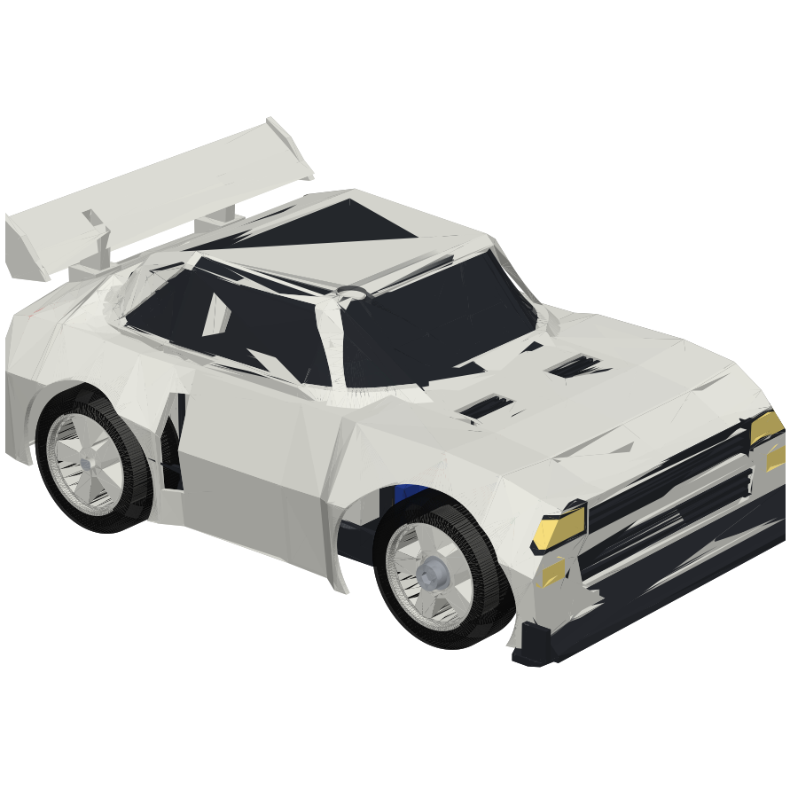
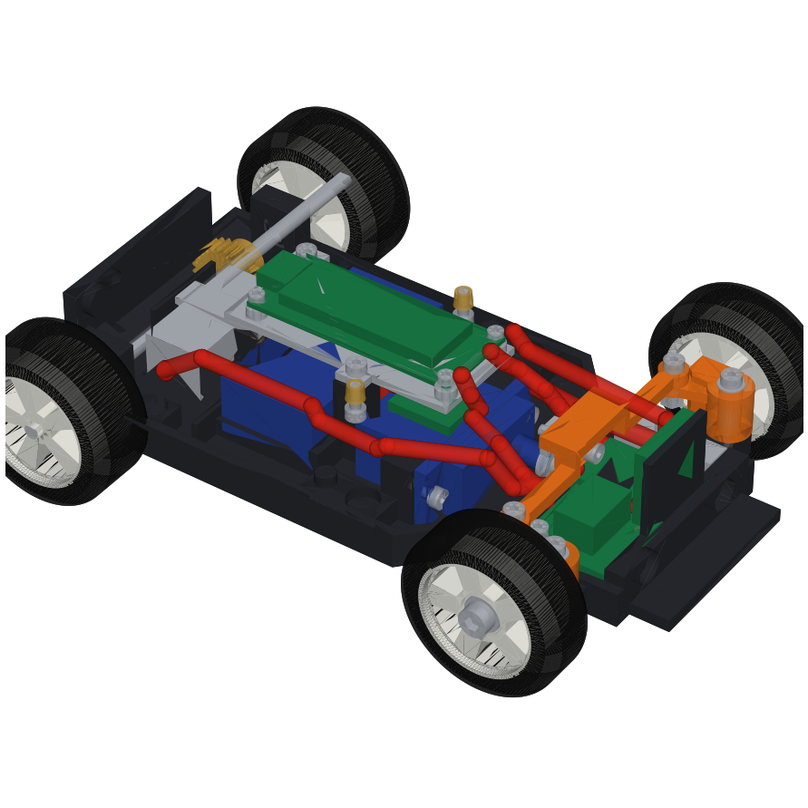
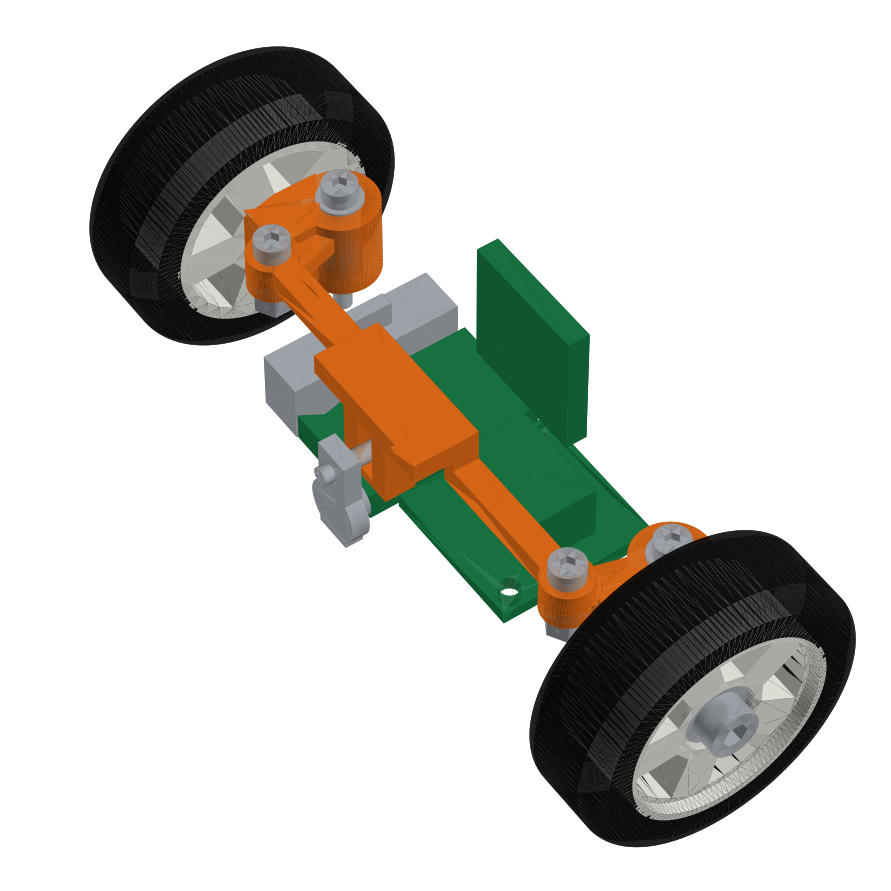

# RC Rally Car

A 3D-printed, phone-controlled rally car, about 15 x 10 x 6.5 cm, styled after a 1980s Group B rally car.
You print the body and chassis, buy the motor, servo, electronics and screws, and drive it from your phone over Bluetooth.



> **Status:** the whole car has been designed and checked in CAD (fits, clearances, steering motion, wiring paths,
> screw lengths: all 20 checks pass). **Nobody has built one yet.** If you do, please open an issue with what worked.

---

## What's in here

| Folder / file | What it is | How to open it |
|---|---|---|
| `stl/` | **Every part you print**, ready for your slicer | Drag into Bambu Studio, PrusaSlicer, Cura or OrcaSlicer. Or click any file here on GitHub to spin it in 3D |
| `BUILD.md` | **Shopping list, wiring, step-by-step build notes** | Click it on GitHub |
| `firmware/rc_car_drive/rc_car_drive.ino` | The code for the car's Arduino | Arduino IDE (steps below) |
| `RC_Car_assembly.step` | The whole assembled car in one file | Any CAD program: Fusion 360, Onshape, SolidWorks, FreeCAD |
| `RC_Car.FCStd` | The full FreeCAD model | FreeCAD 1.0 or newer (free) |
| `rc_car.py` | The script that **generates** every part. Change a number, rerun, get new STLs | FreeCAD (steps below) |
| `rc_car_results.json` | Every check the model passed, with numbers | Any text editor |
| `docs/Rally_Car_Stickers.pdf` | Livery sticker sheet | Print at 100% on white vinyl |

---

## Make one in 6 steps

### 1. Download everything
Click the green **Code** button at the top of this page, then **Download ZIP**, and unzip it.
(Or `git clone` it if you use git.)

### 2. Print the fit test first
Print `stl/FitTest_print_this_first.stl` in the filament you'll use for the car. When your bought parts arrive, check
that each one fits its hole in the test piece (heat inserts, magnet, bearing, spacers, rear axle, motor). If they're
too tight, add 0.1 mm hole compensation in your slicer before printing the real parts.

### 3. Print the car
Open the `stl/` folder in your slicer. Which filament goes where is in [BUILD.md](BUILD.md#print-list-stl);
the short version:

- **Body colour** (white or yellow): Shell, Nose, Tail, Cabin, Wing, the four Rims
- **Black / dark grey**: Tub, Glass, Splitter, Grille, Vent pieces, ElectronicsTray, MotorStrap
- **PETG**: KnuckleL, KnuckleR, TieRod (the steering takes the knocks)
- **TPU 95A**: the four Tires
- Skip the two `ALT_...` gear files unless you decided to print gears instead of buying them

Every part fits a 256 mm printer bed. 0.2 mm layers and 15–20% infill are fine.

### 4. Buy the parts
The full shopping list with part numbers is in [BUILD.md → Bought parts](BUILD.md#bought-parts). Roughly $200–230
for the electronics, motor, servo and battery, plus about $30 of screws, spacers, wire and glue.

### 5. Build it
Follow [BUILD.md](BUILD.md). The parts that need care:
- **Rear axle:** file small flats on the 3 mm rod where the wheels and gear grip it.
- **Front corners:** the knuckles and wheels turn on bought metal spacers. Tighten those screws all the way down.
- **Steering:** drill one hole in the servo horn. The tie-rod lock nuts go just loose enough to swing.
- **Power switch:** the floor switch goes between battery **+** and the switch board's **ON** pin.

### 6. Load the code and drive
1. Install the [Arduino IDE](https://www.arduino.cc/en/software).
2. **Tools → Board → Boards Manager**: install **Arduino Mbed OS Nano Boards**.
3. **Tools → Manage Libraries**: install **ArduinoBLE** and **Servo**.
4. Open `firmware/rc_car_drive/rc_car_drive.ino`. Pick **Arduino Nano 33 BLE** as the board, plug in, click **Upload**.
5. On your phone, install **Adafruit Bluefruit Connect** (iOS / Android). Connect to **"RC Rally"**, then
   **Controller → Control Pad**. Up/Down drive, Left/Right steer, buttons 1 and 2 pick slow or fast mode.

**First drive with the wheels off the ground.** Start with `STEER_TRAVEL = 20` in the code and raise it toward 37 while
watching the steering. Set `STEER_CENTER` so the car goes straight.

---

## Changing the design

Everything is generated from `rc_car.py`. To change something (wheel size, servo screw spacing, horn hole, etc.):

1. Install [FreeCAD](https://www.freecad.org/downloads.php) 1.0 or newer.
2. Edit the number near the top of `rc_car.py`. For example, `SERVO_SCREWS` is the servo mounting hole spacing and
   `HORN_R` is the servo horn hole radius. **Measure your servo: they vary between makers.**
3. In FreeCAD: **Macro → Macros…**, browse to this folder, pick `rc_car.py`, click **Execute**.
   It takes about 10 minutes. It rewrites `stl/`, `RC_Car.FCStd`, `RC_Car_assembly.step` and `rc_car_results.json`.
4. Open `rc_car_results.json` and check that `"all_pass": true` is near the bottom.

Command-line alternative (macOS path shown):
```bash
cd path/to/rc-rally-car && /Applications/FreeCAD.app/Contents/Resources/bin/freecadcmd rc_car.py
```

## Pictures

| Chassis, body off | Front steering |
|---|---|
|  |  |

## Safety

The car runs on a 2S LiPo battery. Charge it only with a balance charger at 0.3 A, never unattended, and don't use a
puffed or damaged pack.

## Credits

The body shape is traced from the 1984 Audi Sport Quattro S1 blueprint by
[GetOutlines](https://getoutlines.com/blueprints/280/1984-audi-sport-quattro-s1-coupe-blueprints), CC BY 4.0.
Sponsor names and logos on the sticker sheet are made up.
